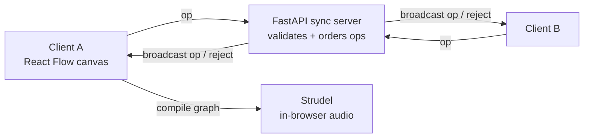

# GrooveGraph

A real-time, multiplayer node canvas for making music. Wire up notes, instruments and effects like a flowchart, and the graph compiles live to [Strudel](https://strudel.cc) code that plays in the browser.

<!-- TODO: demo GIF here — two windows editing the same room, Notes boxes lighting up as they play -->
**[Live demo → groovegraph.app](https://www.groovegraph.app)** — first load may take ~50s while the free server wakes up.

## Why

Strudel is a powerful live-coding engine, but it asks you to learn its pattern syntax before you hear anything. DAWs like FL Studio give you a visual default (the piano roll) but are single-player. GrooveGraph sits between the two: a visual, shareable patch you can build with friends in real time, with the generated Strudel code always one step away.

## Features

- **Node graph → Strudel.** Notes, Instrument, Filter, FX Rack, Arrange and Output nodes compile to a single Strudel pattern on every edit.
- **Live note highlighting.** Each Notes box outlines while it plays; Strudel's trigger hook maps every sounded note back to the box (and position) it came from.
- **Multiplayer rooms.** Share a link and edit the same graph together over WebSockets. Edits show instantly (optimistic) and reconcile with the server's order.
- **Drag claims.** The first person to start dragging a node owns it until they drop it; others see who's editing.
- **Big sound library.** General MIDI soundfonts, Dirt-Samples, VCSL, classic drum machines (SP-12 and more), and built-in supersaw / pulse / chip synths and noise.
- **Effects.** Filters plus crush, coarse, distort, shape, phaser and pan, stacked in an FX rack.
- **Arrange node.** Lay parts out over bars to build song structure.
- **Examples menu.** Demo patches from a first jam to a full song form, opened solo or as a new room.
- **Export / import.** Save your work as an op log and load it back anytime — no account or database needed.

## How it works



- **Op log, not state sync.** Every change is a small op (`addNode`, `moveNodes`, `updateNodeData`, `connect`, `deleteElements`, `setSetting`). The document is just the ops folded over an empty doc, with the same `applyOp` logic implemented in TypeScript (client) and Python (server).
- **Server is the source of order.** The server validates each op (including allowlisted sound ids and effects), assigns it a place in the room's log and broadcasts it, or sends back a reject.
- **Optimistic client.** Each client keeps `confirmed` (server-ordered ops) and `pending` (its own unacknowledged ops). Local edits apply immediately; an echo confirms them, a reject rolls them back, and other people's ops are rebased underneath.
- **Self-healing rooms.** Rooms live in server memory. Share seeds a new room with the sharer's graph, and if the server restarts, the next client to connect re-seeds the room from its own copy.

<!-- TODO (in your own words): why op log over CRDT/state sync, why no database, hardest bug -->

## Tech stack

- **Frontend:** Next.js, React, TypeScript, React Flow (`@xyflow/react`), Strudel (`@strudel/web`, `@strudel/mini`, `@strudel/soundfonts`), Tailwind, Vitest
- **Backend:** Python, FastAPI, WebSockets, Pydantic, pytest
- **Hosting:** server on Render

## Running locally

Prerequisites: Node 20+ and Python 3.11+.

```bash
# sync server (http://localhost:8000)
cd server
pip install -r requirements.txt
uvicorn app.main:app --reload --port 8000
```

```bash
# web app (http://localhost:3000)
cd web
npm install
npm run dev
```

The app works solo without the server; rooms and Share need it running.

### Environment variables

| Variable | Where | Default |
| --- | --- | --- |
| `NEXT_PUBLIC_WS_URL` | web | `ws://localhost:8000` |
| `ALLOWED_ORIGINS` | server (comma-separated) | `http://localhost:3000` |

### Tests

```bash
cd web && npm test        # Vitest: model, compiler, sync convergence, claims
cd server && pytest       # op validation, rooms, seeding, websocket flow
```

## Project structure

```
web/
  src/model/    graph types, applyOp, compile-to-Strudel, sounds and filters
  src/sync/     websocket client, optimistic confirmed/pending state, seeding
  src/canvas/   React Flow wiring, ops dispatch, drag claims
  src/nodes/    node components (Notes, Instrument, FX Rack, Arrange, ...)
  src/audio/    Strudel playback and live note highlighting
server/
  app/          FastAPI app, rooms, Python applyOp, message protocol
  tests/
shared/fixtures/  starter graph and demo patches used by both sides
```

## Roadmap

- **Grid pad node** — a step / piano-roll style grid for entering notes without learning Strudel's mini-notation. This came from feedback from a working bar DJ in LA: producers reach for a piano roll first, and today the text Notes box is the main barrier. Inspired by the grid pad in [Strudel Flow](https://flow-machine.xyflow.com/) by the React Flow (xyflow) team. It would compile to the same mini-notation the Notes box produces, so it needs no engine changes.
- Persistent rooms (currently in-memory; export/import covers saving).

## License

AGPL-3.0-or-later (see [LICENSE](LICENSE)), the same license as [Strudel](https://strudel.cc), which this app builds on. The app's footer credits Strudel and links back to this repo.
